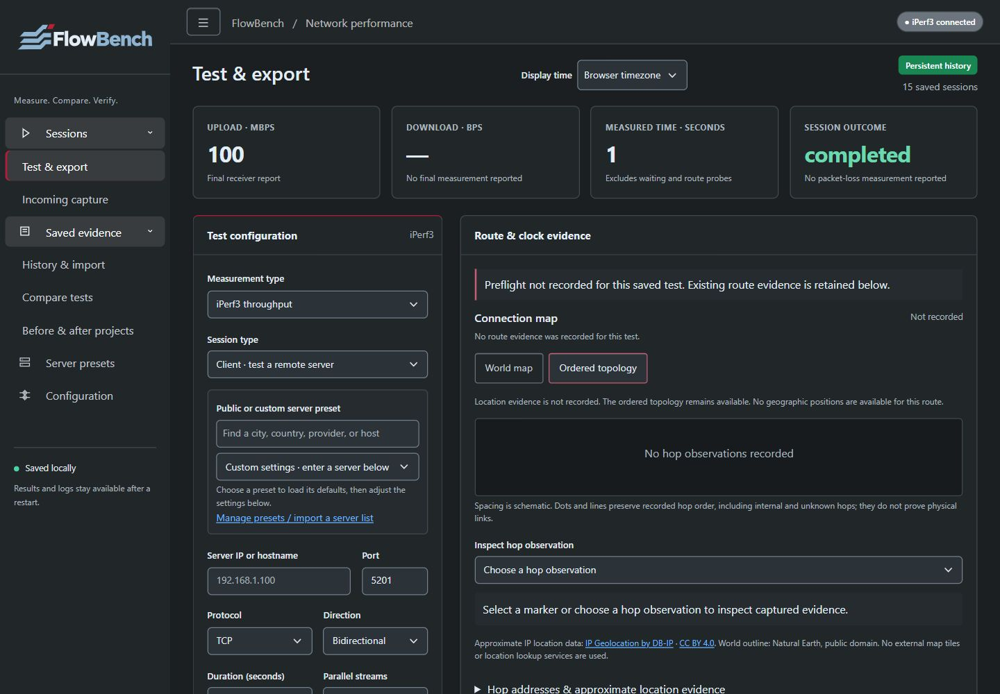
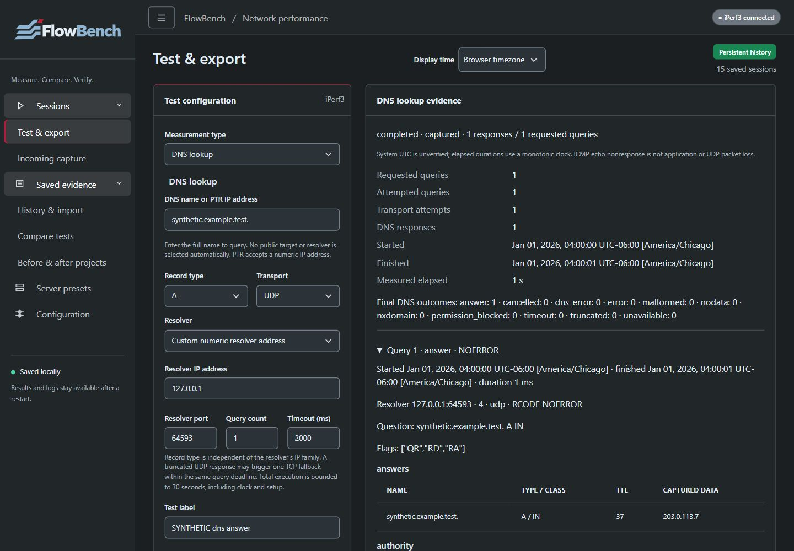

# FlowBench

The current **main source (`0.2.0-dev`)** includes [DNS/ICMP checks and Run again](docs/network-checks.md), [route and clock evidence](docs/preflight.md), [measurement workflows](docs/measurement-workflows.md), [optional native Flent RRUL](docs/flent.md), and [PDF/Word reports](docs/reports.md). Build main to use these features. Published **0.1.0-rc.2** source and image downloads remain unchanged and do not contain these additions. Other proposed diagnostics remain on the [roadmap](docs/roadmap.md).

The separate **`feature/test-endpoints` branch** is adding [captured test endpoints and execution context](docs/test-endpoints.md). It is under implementation/review; main and published rc.2 downloads do not include that addition yet.

[](https://github.com/Super8Four/flowbench/actions/workflows/container.yaml?query=branch%3Amain) [](https://github.com/Super8Four/flowbench/releases) [](docs/setup-and-testing.md) [](docs/setup-and-testing.md) [](docs/setup-and-testing.md) [](docs/sqlite-storage.md) [](docs/protocol-tests.md)

<picture>
  <source media="(prefers-color-scheme: dark)" type="image/svg+xml" srcset="app/static/brand/flowbench-logo-dark.svg">
  
</picture>

**Measure. Compare. Verify.**

Run iPerf3 tests, query DNS, observe ICMP echoes, capture incoming sessions and compare saved results. FlowBench keeps settings, measurements, logs and notes in a portable SQLite archive. Run again creates a new execution linked to its saved source.



*Current-main screen with disposable synthetic evidence. [More screenshots](docs/verification.md).*

## Start on Ubuntu

**[Installation wiki](docs/install/README.md)** — Windows, native Linux, Docker/Compose and Raspberry Pi ARM64.

For current main, clone the source and build with Docker Engine and Compose v2:

```sh
git clone https://github.com/Super8Four/flowbench.git
cd flowbench
git switch main
docker compose config --quiet
docker compose build --build-arg VCS_REF="$(git rev-parse HEAD)"
docker compose up -d --wait
curl --fail http://127.0.0.1:5000/api/ready
```

Open **http://127.0.0.1:5000**. To reproduce the older prerelease instead, use its tag and matching images: [0.1.0-rc.2 downloads](https://github.com/Super8Four/flowbench/releases/tag/v0.1.0-rc.2) include source, native AMD64/ARM64 container images and checksums. This is a prerelease. See [setup](docs/setup-and-testing.md) for loading an image, Windows installation, port mappings and troubleshooting.

## Run a test

1. Start `iperf3 -s` on a server you have permission to test. Tests run from the FlowBench host.
2. Choose TCP, UDP or **Both** and a direction. New tests default to bidirectional. Both runs TCP then UDP and keeps their results separate.
3. Start the test, review throughput and logs, then export JSON/XML or save notes. Stopping keeps the output already captured.
4. Use **History** to search/import sessions and **Compare tests** to add completed tests, choose their colors and compare actual elapsed measurements. Shorter tests end at their captured duration; stored rates keep their original numeric units while the interface scales bps through Tbps.

To receive tests, enable the listener in **Configuration**. Incoming iPerf3 clients are saved automatically. One incoming test can run alongside one outgoing test; overlap may affect measurements and is labeled. The listener restarts with the app until you turn it off. See [incoming capture](docs/incoming-listener.md).

## Check DNS or ICMP



*Synthetic demonstration using an owned loopback resolver and reserved answer addresses.*

Choose **DNS lookup** to query a name and record type through a configured system resolver or a chosen numeric resolver. The saved evidence distinguishes answers, NXDOMAIN, DNS errors, timeouts and incomplete captures. No public resolver is silently substituted.

Choose **ICMP echo check** for bounded observations of a hostname or address. Unknown sends and strict RTT bounds stay explicit; ICMP nonresponse is not application or UDP packet loss. Tool availability and permissions vary by host.

History keeps each check separately. Compare terminal checks of the same type, review report redaction, or click **Run again** to start a fresh linked execution from saved configuration. Use **Load settings** to review or edit a draft before starting. Incoming reruns and Flent show a review panel requiring a fresh bounded-wait or Netserver confirmation. See [checks and rerun details](docs/network-checks.md).

Outgoing throughput tests retain ordered route and local clock evidence. Optional geographic markers need an independently supplied, licensed local database; no dataset is bundled or downloaded automatically. Missing locations or unverified clock quality remain visible without inventing evidence. See [route, clock and offline map setup](docs/preflight.md).

## Keep your history

The archive lives at `/data/runs/archive.sqlite3` in the persistent `iperf_data` volume. Keep that volume when replacing the image. Back up the complete archive with the app stopped.

Older JSON/JSONL archives import once without changing the source files. See [migration, backup and rollback](docs/sqlite-storage.md) before upgrading or moving hosts.

## Limits

The API has **no login**. Keep it on localhost or behind authenticated access. Listener bind settings do not change host port mappings or firewall rules.

These development features require current main; downloading rc.2 does not upgrade its contents. The Windows engine does not support UDP bidirectional; use a Linux image or select upload/download. Actual Flent execution requires optional Linux tools and a controlled Netserver peer. Public server listings may be unavailable or have different limits. Profiles/thresholds, retention, authentication and instance coordination remain planned. Pi deployment and broader acceptance are still unverified.

## Documentation

- [Setup and troubleshooting](docs/setup-and-testing.md)
- [TCP, UDP and Both](docs/protocol-tests.md)
- [Route and clock preparation](docs/preflight.md)
- [DNS, ICMP and Run again](docs/network-checks.md), [planned diagnostics](docs/roadmap.md)
- [Incoming capture](docs/incoming-listener.md)
- [Test endpoints and context](docs/test-endpoints.md) - branch preview, review pending
- [Backup and rollback](docs/sqlite-storage.md)
- [Brand assets](docs/brand-assets.md), [verification](docs/verification.md) and [remaining requirements](docs/requirements.md)
- [Changelog](CHANGELOG.md), [release notes](docs/release-0.1.0-rc.2.md) and [third-party notices](THIRD_PARTY_NOTICES.md)
