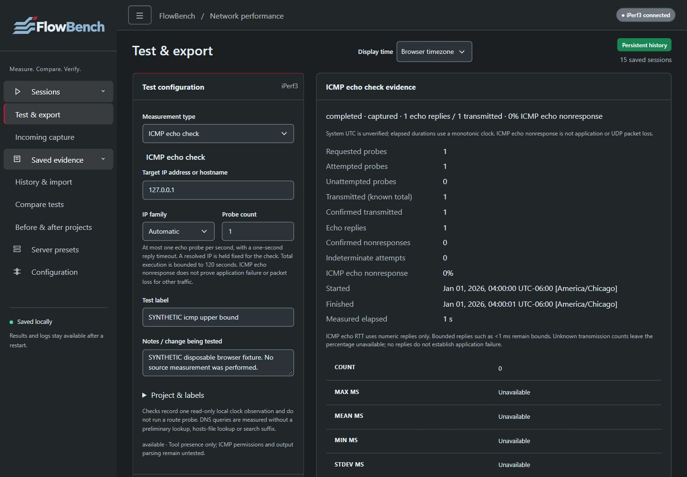

# Install FlowBench

      

Choose the method that fits your host. The guides below install **current main (`0.2.0-dev`)**, including DNS/ICMP checks, Run again, route/clock evidence, offline geographic views and measurement reports. These additions are merged source features, not a new published release.

## Choose a source version

Fresh-clone examples use `git switch main`. Record `git rev-parse HEAD` when building so a test result or image can be tied to its exact source. Main can continue changing; consult [verification](../verification.md) for checked revisions and remaining limits.

To reproduce published [0.1.0-rc.2](https://github.com/Super8Four/flowbench/releases/tag/v0.1.0-rc.2), select `git switch --detach v0.1.0-rc.2` after cloning, or load its matching checksummed image. Its tag and downloads remain unchanged and do not gain current-main features. Use one version's source, dependencies and container metadata together.

## Choose an installation

| Method | Guide | Verification |
| --- | --- | --- |
| Windows native | [Windows](windows.md) | Python 3.12, the checksummed Windows iPerf3 3.22 build, local startup and regression tests |
| Ubuntu native | [Linux](linux.md) | Ubuntu/Python/iPerf build commands are exercised in native container CI; a standalone Linux host install has not been separately tested |
| Ubuntu container, AMD64/ARM64 | [Docker and Compose](containers.md) | Native builds, full tests and persistent-volume lifecycle checks on both architectures |
| Raspberry Pi ARM64 | [Raspberry Pi](raspberry-pi.md) | ARM64 images tested in CI; physical Pi deployment/performance untested |

*Synthetic saved ICMP observations illustrate explicit RTT limits; they are not measurements of an external network.*

- [Configuration, ports and data](configuration.md)
- [Upgrades, backups, rollback and removal](maintenance.md)
- [Troubleshooting](troubleshooting.md)
- [Verification](../verification.md) and [release notes](../release-0.1.0-rc.2.md)

The API has no login. Keep the web port local or behind authenticated access. All examples retain loopback defaults; installation does not configure a firewall or make a test server publicly reachable. Run one app process per archive.

The SVG logo and PNG fallback are included with source and container downloads. There is no separate database server, one-click installer, Windows container image or published container registry image.

Current main installs dnspython for DNS queries and the local MMDB reader through `requirements.txt`. Native ping permissions and local clock-service evidence remain host dependent; no privilege changes are made automatically. Geographic data is optional, separately licensed and never bundled or downloaded by the app. See [checks and reruns](../network-checks.md), [route/clock and offline map setup](../preflight.md), and [optional Flent](../flent.md).
