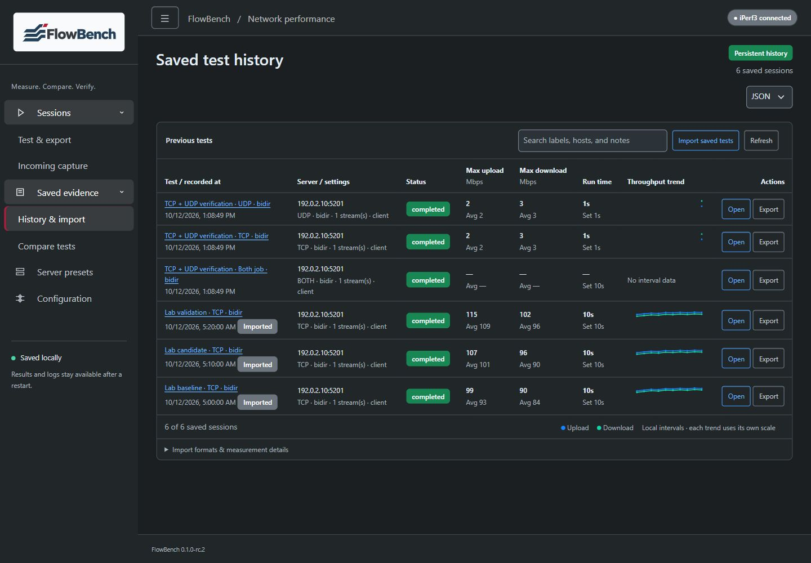
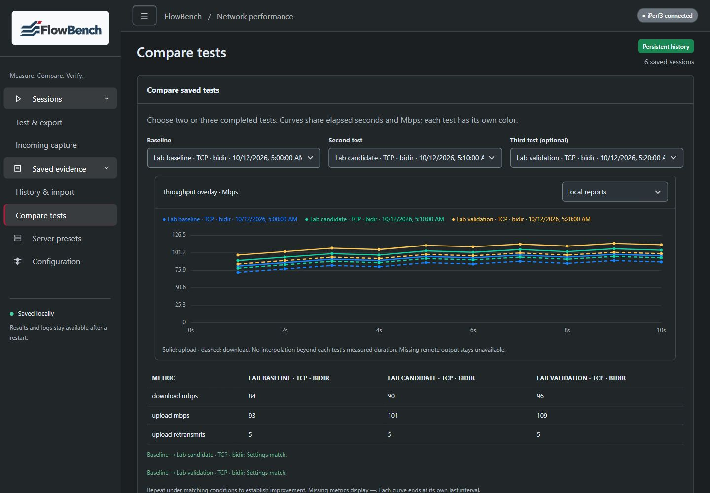
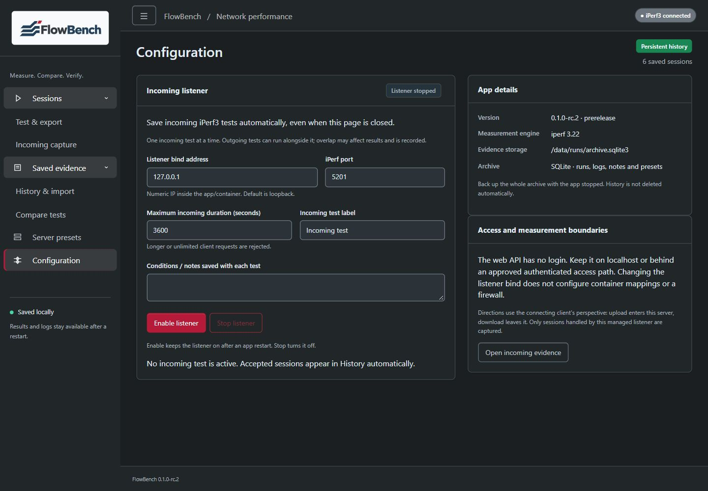
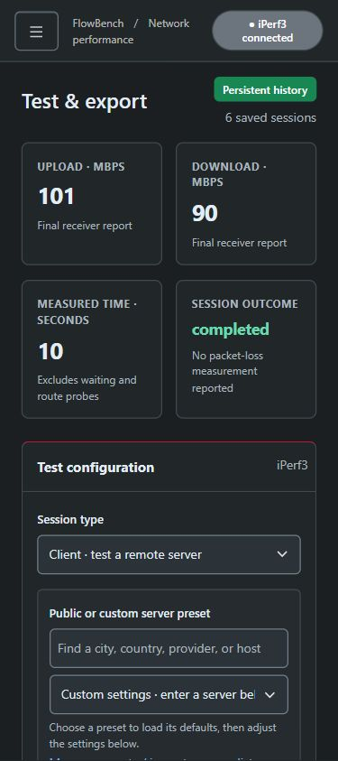
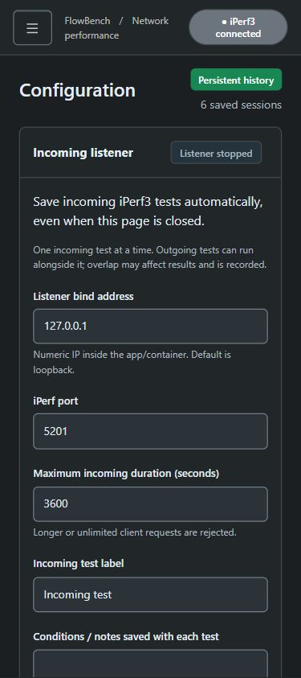
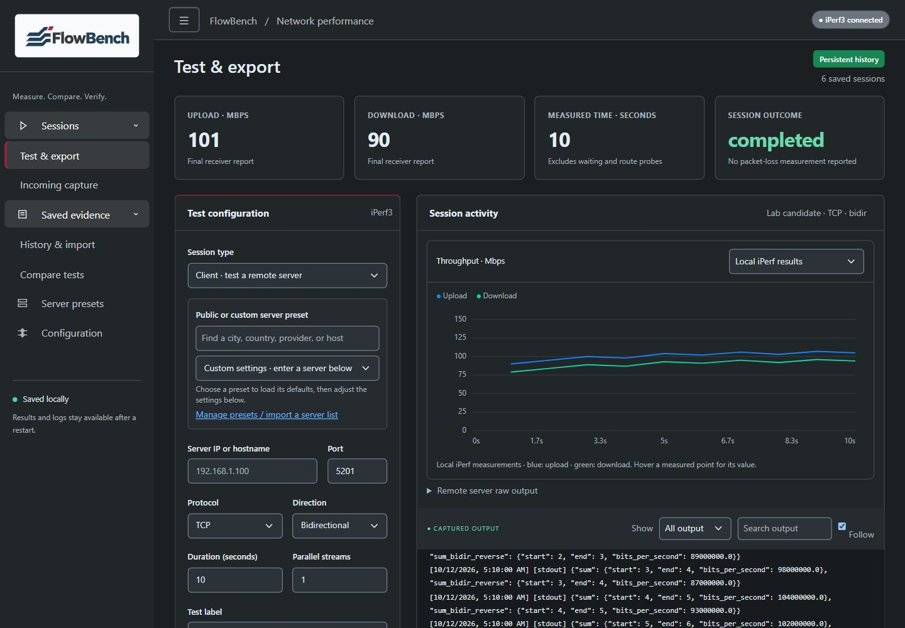
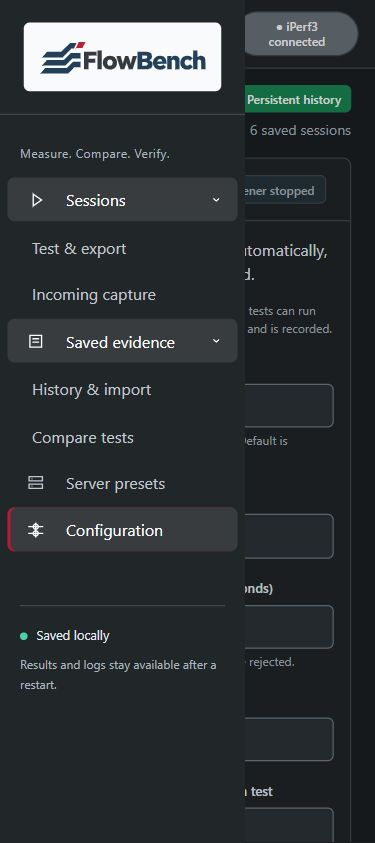

# FlowBench verification and screenshots

   

## Repeatable checks

Run `python -m unittest discover -s tests -v` with a verified iPerf3 engine. All 89 tests passed locally on Windows with Python 3.12 and the pinned 3.22 engine. The suite covers SQLite migration/rollback/import/export, simultaneous readers/capture/notes, actual lock contention/page exhaustion, denied writes, interrupted transactions/recovery, protocol job identity/outcomes, and managed listener raw-client captures, stop/resume/errors. Native Linux additionally executes UDP bidirectional; Windows checks its explicit rejection.

The branch CI builds Ubuntu images on native AMD64 and ARM64 runners, runs the suite inside each image, then `scripts/check-container.py`. That script creates its own disposable container and volume, tests legacy migration, real TCP/UDP/Both, remote reports, JSON/XML round trips, managed incoming clients, independent overlap, resume without duplication, graceful incoming/outgoing stop and evidence/preset persistence after replacement. It verifies architecture, non-root/read-only runtime and SQLite integrity. No production Compose project/archive or live target is used.

Release publication requires terminal success for both native jobs at the exact source commit, followed by checked artifact hashes/OCI revision labels and verification that the release tag resolves to that commit. The live branch badge follows the named feature branch; it does not represent main or a stable release. The release page records the exact source and run.

## Browser QA

The UI was checked through the actual Edge browser with a disposable loopback fixture and synthetic records at CSS viewports 1440×1000, 375×843 and 843×375. Checks included wrapping, scrolling tables, three-test comparison, keyboard skip/sidebar navigation, listener validation/error-summary focus, missing remote evidence, empty search results and reduced-motion styling. Injected archive failure showed the error and disabled listener/outgoing controls; restoring access restored normal state. No application console errors were observed. Screenshots retain the supplied logo; private reference pictures are excluded. Browser captures below show the actual UI with synthetic measurements and reserved example endpoints.

Targeted checks do not certify full WCAG compliance, close all UI/audit requirements, establish hardware durability/power-loss recovery or demonstrate a Pi deployment. Full/comparison charts draw measured samples directly and break paths across missing spans. History sparklines are bounded summaries with their own scale. Available controls/data remain limited to the implementation described in [requirements](requirements.md).

### Test and export

### Persistent history

### Three-test comparison

### Configuration and incoming capture

### Mobile

## 0.1.0-rc.2 vector logo checks

The supplied SVG was inspected as actual browser pixels at large and sidebar sizes before integration. It contains only SVG/title/description/path elements with outlined lettering and solid brand fills; there are no scripts, fonts, embedded raster, links or external dependencies. New checks verify this safe asset contract, HTTP MIME/bytes, accessible SVG preference and PNG fallback across pages. Container lifecycle checks fetch both assets from the running image and compare the app/image version. Exact-source native CI results are linked in the release notes.

The SVG update was also checked in the actual app on desktop and mobile. The gallery captures above and below have been refreshed for rc.2 with synthetic records; rc.1 keeps its original screenshots in the immutable tag.

