# FlowBench verification and screenshots

      

## Current source and repeatable checks

Current main is unreleased `0.2.0-dev`, including route and read-only clock evidence, offline connection maps, DNS and ICMP checks, Run again, measurement workflows, actual optional Linux Flent and PDF/Word reports. PRs [10](https://github.com/Super8Four/flowbench/pull/10) and [21](https://github.com/Super8Four/flowbench/pull/21) were merged in order. Their combined code is commit `22f15addf6b0e232bbe6dcf44d57705ce9b546b3`; its file tree matches the tested feature commit `010177c5b85802dd89779e3d530965a5867efeba`. The latest published downloads remain rc.2. Use the exact source SHA and terminal CI run, rather than a changing badge, to identify tested code. [Testing](testing.md) maps meaningful checks and platform limits; [lifecycle](lifecycle.md) describes review and release evidence.

Run `python -m unittest discover -s tests -v` with the verified engine and dependencies. Source/Windows and native AMD64/ARM64 workflows exercise archive transaction/concurrency/error/restart, JSON/XML import/export, protocol/listener behavior, measurement workflows, report privacy, native Flent and report rendering. Node-dependent wrappers can skip in the Node-free image; actual controller behavior is exercised separately in the source job. Read the test summary, including skips, for the exact commit.

At combined main `22f15ad`, [source and Windows CI](https://github.com/Super8Four/flowbench/actions/runs/38509114032) and [native Ubuntu CI](https://github.com/Super8Four/flowbench/actions/runs/38509114070) completed successfully. Windows passed all 359 tests. Each native architecture passed 353 of 359 tests and skipped six Node-dependent wrappers; all six controller fixtures passed separately in source CI. Container persistence/restart, actual Flent rerun/retry/cancellation, report layout and image packaging checks passed on both architectures. These results do not describe an installation on a physical Pi.

The final feature report review at `010177c5` accounted for 212 pages across both architectures: 94 direct PDF pages and 118 LibreOffice-converted Word pages. Unchanged pages were matched to reviewed pixels; changed timestamp/footer regions and the corrected former blank-page position were inspected. The merged code tree is identical, and native report generation/layout checks also passed at `22f15ad`. Microsoft Word itself and every possible user dataset were not tested.

## Current browser captures

The refreshed gallery captures the actual merged application at `22f15ad` with a disposable SQLite archive and clearly labelled synthetic records. No private archive, reference image or external endpoint is published. Route/location examples are fixtures, not measured geography or activated DB-IP data. Graphics are self-contained SVG; screenshots remain raster images. The supplied original logo/PNG remain unchanged. Its dark-surface SVG uses the identical outlines, a light foreground/navy tint and unchanged crimson, with transparent clear space. The sidebar and mobile header render it directly without a white plaque. See [asset usage](brand-assets.md).

Targeted browser checks cover the seven application routes, desktop widths of 1440 and 1151 CSS pixels, mobile 375x842 and landscape 842x375, navigation opening/closing, keyboard focus and page overflow. Fourteen new JPEG captures replace the current gallery's older examples; historical image files remain available. Native route/clock providers and external network traffic were not invoked for these screenshots. These checks do not establish full WCAG certification, physical Pi deployment, external network performance or power-loss durability.

### Test and export

### DNS and ICMP observations

### Fresh attempts

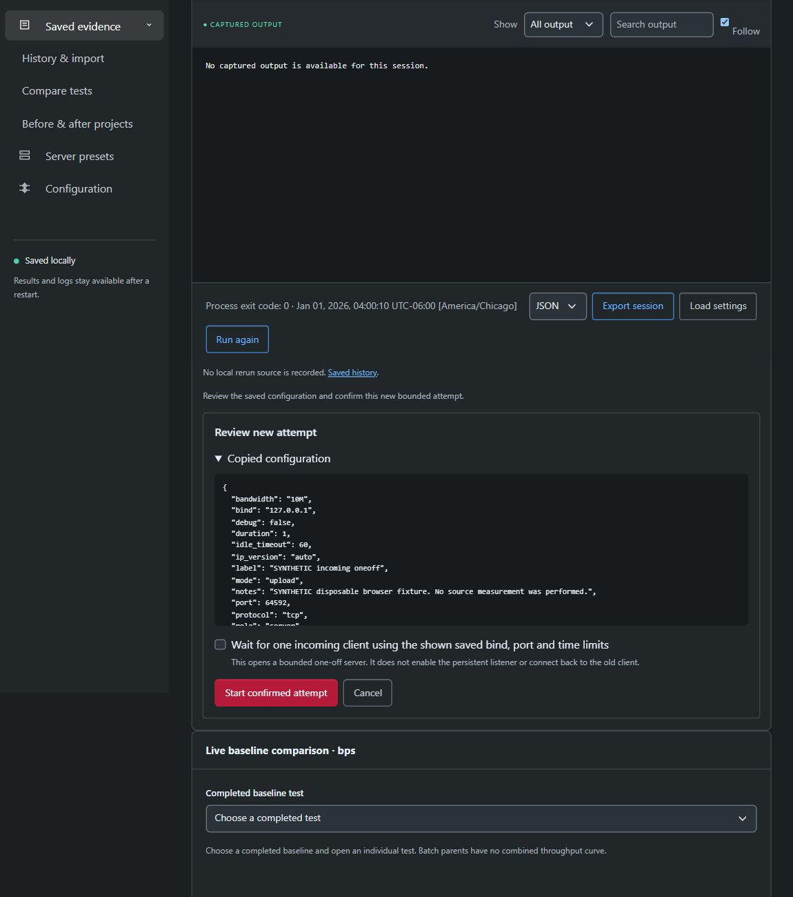

### Persistent history

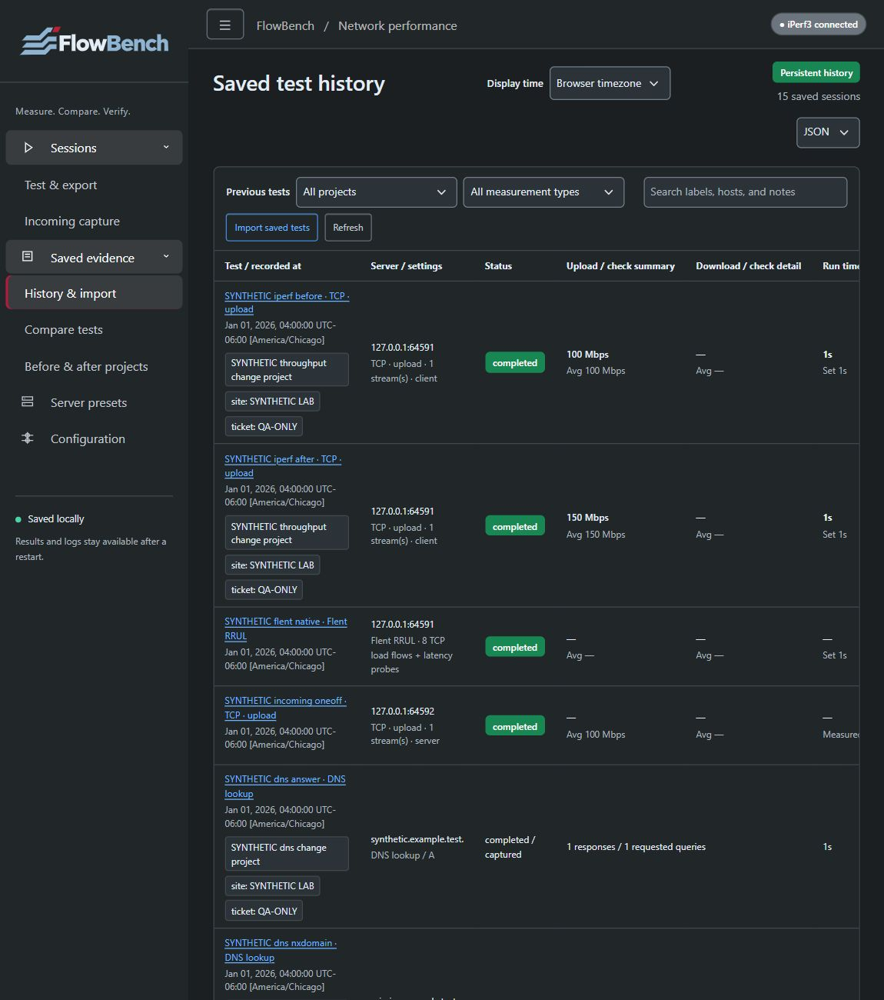

### Typed comparisons

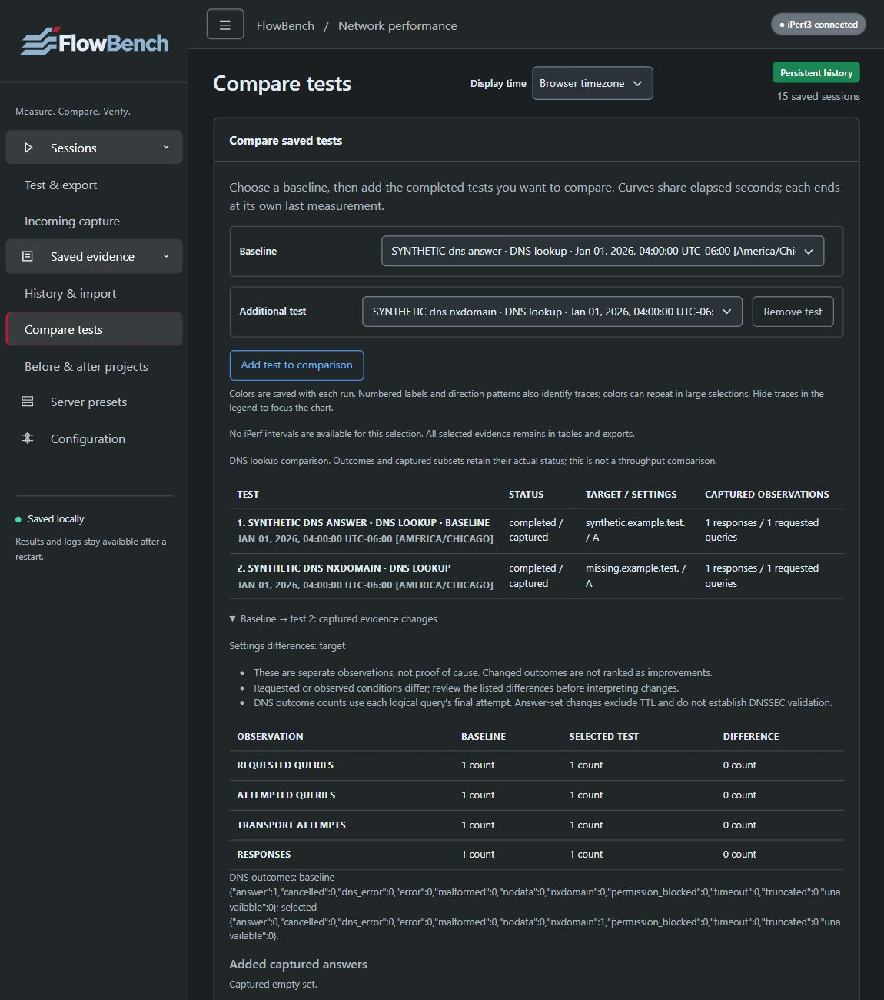

### Before/after projects

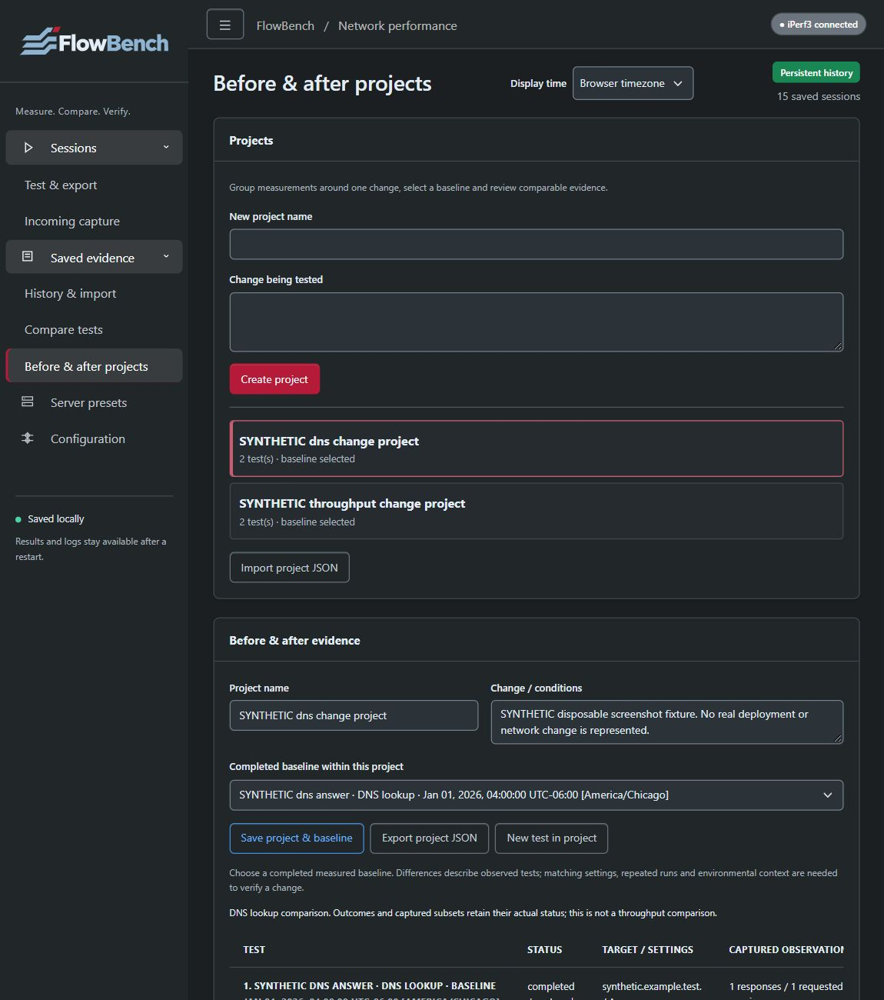

### Incoming capture and configuration

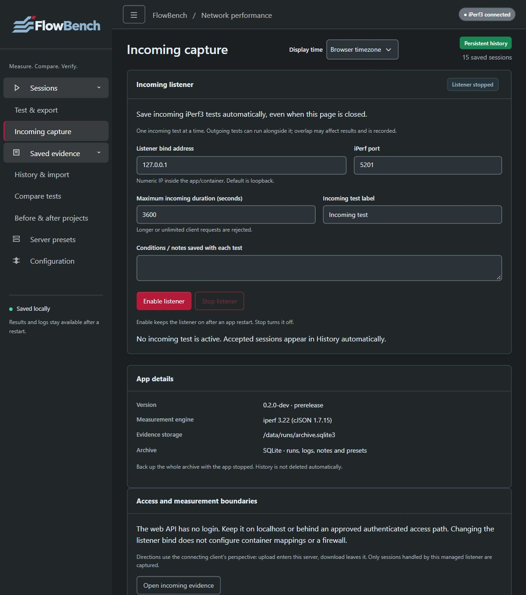

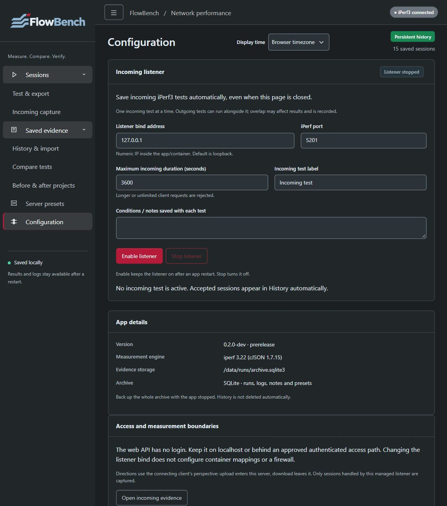

### Server presets

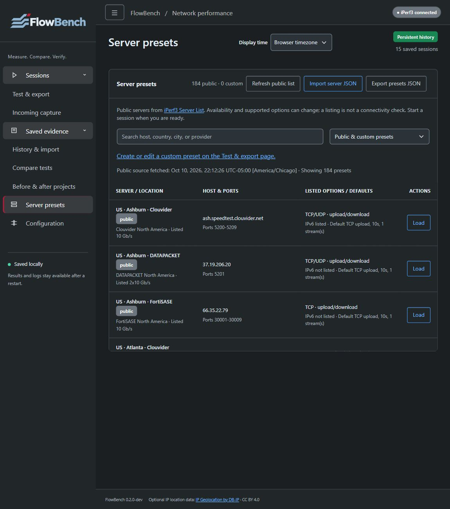

### Mobile and landscape

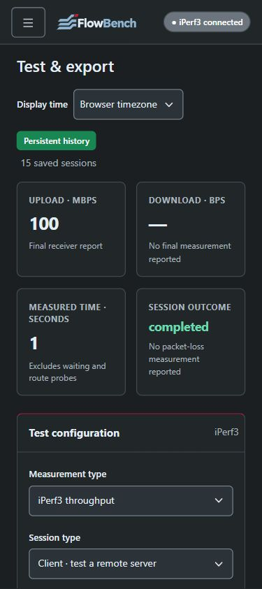

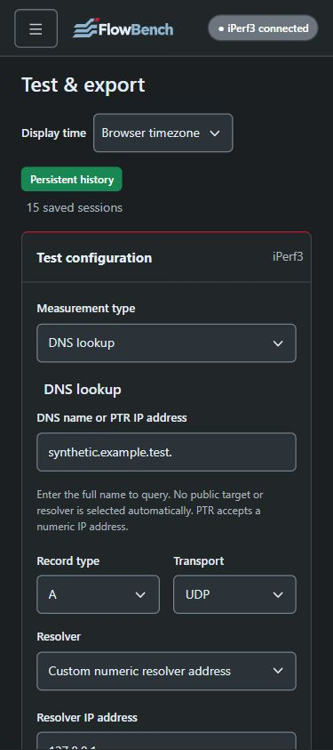

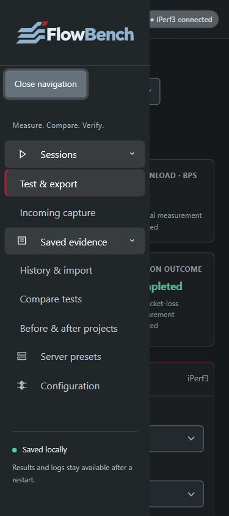

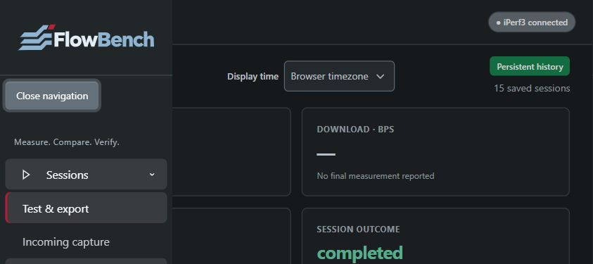

## Report-download verification boundary

Actual UI requests produced valid redacted individual and five-run PDF/DOCX responses. Repeat requests, invalidated previews, the genuine stale-fingerprint rejection and controlled generation-error recovery were exercised. Supported browser download methods timed out for both the app and a plain local attachment control; final browser file saves remain unconfirmed. Captured HTTP response bodies are not browser-saved artifacts. This documented limitation was accepted for integration and is not reported as a passed browser save.

## Historical prerelease evidence

The rc.1/rc.2 tags retain their original verification pages and screenshots. At rc.2, 89 local Windows tests and both exact-source native jobs passed, with the original SVG preferred over PNG on a light sidebar plaque. Those screenshots and downloads describe that historical release. Earlier `integrated-*`, `preflight-*` and `svg-logo-*` captures remain in the repository as historical evidence; they are not relabelled as new captures. The [rc.2 release notes](release-0.1.0-rc.2.md) identify its source and checks; existing published tags/assets remain immutable.
