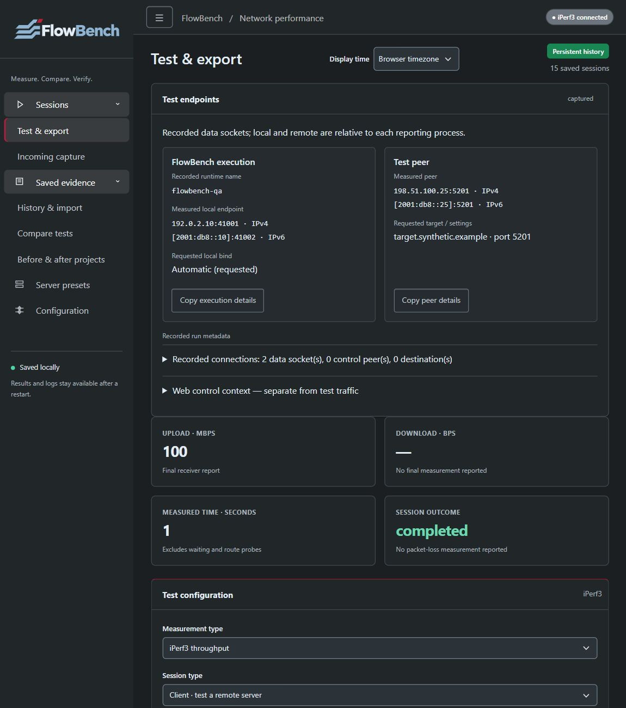
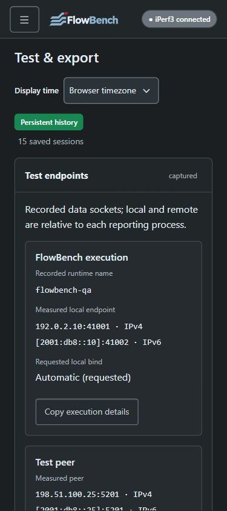

# FlowBench verification and screenshots

      

## Release verification

The [0.2.0-rc.1 release page](https://github.com/Super8Four/flowbench/releases/tag/v0.2.0-rc.1) identifies its immutable source commit, terminal CI runs and six native image/metadata/checksum assets. Follow the [release notes](release-0.2.0-rc.1.md) for installation, upgrade and remaining limits. Current-main badges can change after publication.

The release includes the endpoint warning correction from [PR25](https://github.com/Super8Four/flowbench/pull/25). Its model regression reproduced 20 incorrect promotions on the old main, and a parser/SQLite regression reproduced the warning loss in the first streamed start transaction. The correction passed 406 local tests with zero skips and exact-source Windows/native CI. Historical labels already saved as captured are not rewritten.

ReportLab 5.0.1 and the dependency minimum updates are reviewed through [PR9](https://github.com/Super8Four/flowbench/pull/9). Fresh native rendering is checked independently of the older renderer's pages. Release CI and the release-page evidence distinguish generated/layout-checked output from manual visual review.

## Release UI and screenshot provenance

The README retains the actual desktop and mobile endpoint captures documented below. They were captured at `2d2c882`; the release uses the same static assets and templates. The version label and backend dependency/status corrections are checked separately. They are not new release-source screenshots.

Fresh browser capture was attempted during release preparation, but no browser surface was connected and both Edge and the in-app browser reported unavailable after retries. Earlier actual desktop/mobile/keyboard checks and the release's controller/API regressions remain identified by source; fresh interactive browser acceptance is unrun. No screenshot was reconstructed, relabelled as a newer capture or taken from a private archive. The supplied SVG/PNG geometry and transparent dark variant are unchanged.

## Historical integration evidence (22f15ad)

The earlier main integration included route and read-only clock evidence, offline connection maps, DNS and ICMP checks, Run again, measurement workflows, actual optional Linux Flent and PDF/Word reports. PRs [10](https://github.com/Super8Four/flowbench/pull/10) and [21](https://github.com/Super8Four/flowbench/pull/21) were merged in order. Their combined code is commit `22f15addf6b0e232bbe6dcf44d57705ce9b546b3`; its file tree matches the tested feature commit `010177c5b85802dd89779e3d530965a5867efeba`. Those results describe that earlier integration, not the new release commit. Use the exact source SHA and terminal CI run, rather than a changing badge, to identify tested code. [Testing](testing.md) maps meaningful checks and platform limits; [lifecycle](lifecycle.md) describes review and release evidence.

Run `python -m unittest discover -s tests -v` with the verified engine and dependencies. Source/Windows and native AMD64/ARM64 workflows exercise archive transaction/concurrency/error/restart, JSON/XML import/export, protocol/listener behavior, measurement workflows, report privacy, native Flent and report rendering. Node-dependent wrappers can skip in the Node-free image; actual controller behavior is exercised separately in the source job. Read the test summary, including skips, for the exact commit.

At combined main `22f15ad`, [source and Windows CI](https://github.com/Super8Four/flowbench/actions/runs/38509114032) and [native Ubuntu CI](https://github.com/Super8Four/flowbench/actions/runs/38509114070) completed successfully. Windows passed all 359 tests. Each native architecture passed 353 of 359 tests and skipped six Node-dependent wrappers; all six controller fixtures passed separately in source CI. Container persistence/restart, actual Flent rerun/retry/cancellation, report layout and image packaging checks passed on both architectures. These results do not describe an installation on a physical Pi.

The final feature report review at `010177c5` accounted for 212 pages across both architectures: 94 direct PDF pages and 118 LibreOffice-converted Word pages. Unchanged pages were matched to reviewed pixels; changed timestamp/footer regions and the corrected former blank-page position were inspected. The merged code tree is identical, and native report generation/layout checks also passed at `22f15ad`. Microsoft Word itself and every possible user dataset were not tested.

## Endpoint integration evidence

Current main includes the Test endpoints feature delivered through [PR24](https://github.com/Super8Four/flowbench/pull/24). That PR records the final integration commit and its post-merge CI, separately from the feature results below. Existing rc.2 tags/downloads remain unchanged.

Feature commit `7262c1207a345ebb2daffdee6546b016bc285e35` passed [push source/Windows](https://github.com/Super8Four/flowbench/actions/runs/38608627328), [push native AMD64/ARM64](https://github.com/Super8Four/flowbench/actions/runs/38608627077), [PR source/Windows](https://github.com/Super8Four/flowbench/actions/runs/38608638466) and [PR native](https://github.com/Super8Four/flowbench/actions/runs/38608638496). The PR tested merge `e462690abbce45dd21b9052f08c292513c4f8215`, whose tree matches that feature commit. Each Windows suite passed 402 tests without skips; each native suite passed 395 of 402 with seven Node-wrapper skips, and all seven controller fixtures passed separately. Actual IPv6 endpoint capture, archive/restart lifecycle, native Flent, PDF/Word gates and image packaging passed. These exact-source results do not certify later commits.

The initial `2d2c882` ARM64 run failed because a single-test Word report ended with a blank seventh page. The correction at `7262c12` removes trailing empty body paragraphs, preserves final table rows and adds a regression. Final push artifacts account for 233 reviewed pages: 116 AMD64 and 117 ARM64. Exact pixel matches reused reviewed references; changed pages received labelled contact-sheet review, with critical pages additionally opened at native size. No visible layout defects were found. Word output was converted with LibreOffice; Microsoft Word itself was not tested.

These two screenshots are actual Edge captures of a disposable synthetic archive at `2d2c882`; its endpoint UI is identical to `7262c12` (only the report renderer/regression changed). Reserved IPv4/IPv6 addresses, the synthetic `flowbench-qa` hostname and requested target are examples, not private user history or external network measurements. Earlier gallery images below retain their own source provenance.

Actual browser checks covered desktop, 375/320-pixel mobile and 842-pixel landscape widths, keyboard disclosure focus through polling, separate saved/current web context, copy feedback, pending/cancelled states and a fresh completed owned-loopback test after cancellation. OS clipboard contents were not independently confirmed by the browser clipboard read; controller fixtures verify copy text and denied-copy fallback. Physical Pi deployment, external NAT/public-address interpretation and full screen-reader/WCAG acceptance remain unrun. No running user app was upgraded for these checks.

## Earlier merged browser captures (22f15ad)

The refreshed gallery captures the actual merged application at `22f15ad` with a disposable SQLite archive and clearly labelled synthetic records. No private archive, reference image or external endpoint is published. Route/location examples are fixtures, not measured geography or activated DB-IP data. Graphics are self-contained SVG; screenshots remain raster images. The supplied original logo/PNG remain unchanged. Its dark-surface SVG uses the identical outlines, a light foreground/navy tint and unchanged crimson, with transparent clear space. The sidebar and mobile header render it directly without a white plaque. See [asset usage](brand-assets.md).

Targeted browser checks cover the seven application routes, desktop widths of 1440 and 1151 CSS pixels, mobile 375x842 and landscape 842x375, navigation opening/closing, keyboard focus and page overflow. Fourteen JPEG captures refreshed this earlier gallery; historical image files remain available. Native route/clock providers and external network traffic were not invoked for these screenshots. These checks do not establish full WCAG certification, physical Pi deployment, external network performance or power-loss durability.

### Test and export

### DNS and ICMP observations

### Fresh attempts

### Persistent history

### Typed comparisons

### Before/after projects

### Incoming capture and configuration

### Server presets

### Mobile and landscape

## Report-download verification boundary

Actual UI requests produced valid redacted individual and five-run PDF/DOCX responses. Repeat requests, invalidated previews, the genuine stale-fingerprint rejection and controlled generation-error recovery were exercised. Supported browser download methods timed out for both the app and a plain local attachment control; final browser file saves remain unconfirmed. Captured HTTP response bodies are not browser-saved artifacts. This documented limitation was accepted for integration and is not reported as a passed browser save.

## Historical prerelease evidence

The rc.1/rc.2 tags retain their original verification pages and screenshots. At rc.2, 89 local Windows tests and both exact-source native jobs passed, with the original SVG preferred over PNG on a light sidebar plaque. Those screenshots and downloads describe that historical release. Earlier `integrated-*`, `preflight-*` and `svg-logo-*` captures remain in the repository as historical evidence; they are not relabelled as new captures. The [rc.2 release notes](release-0.1.0-rc.2.md) identify its source and checks; existing published tags/assets remain immutable.
