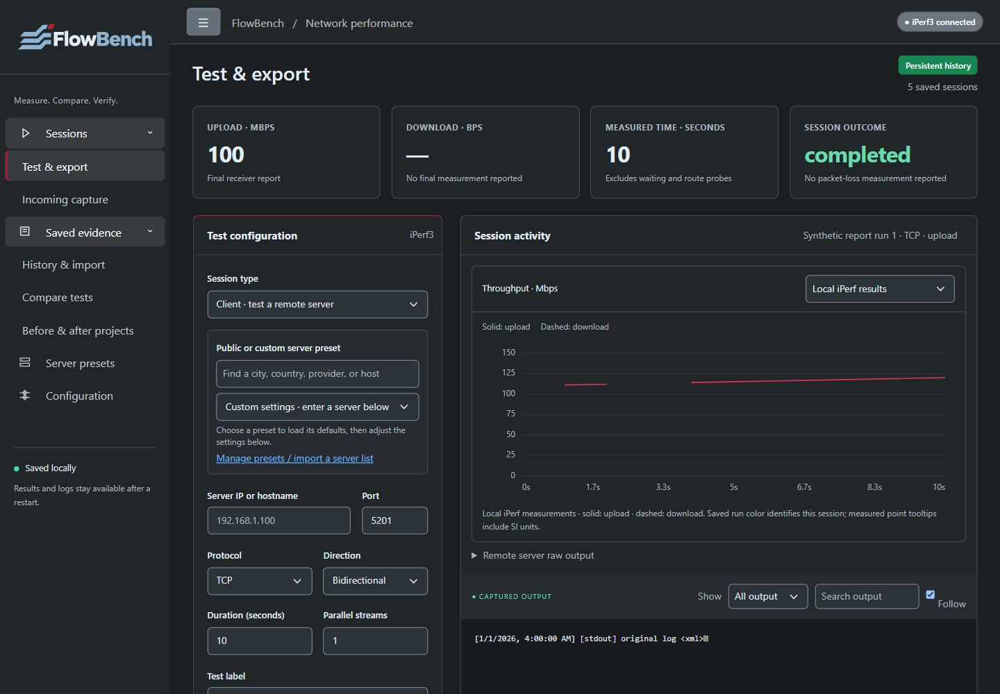
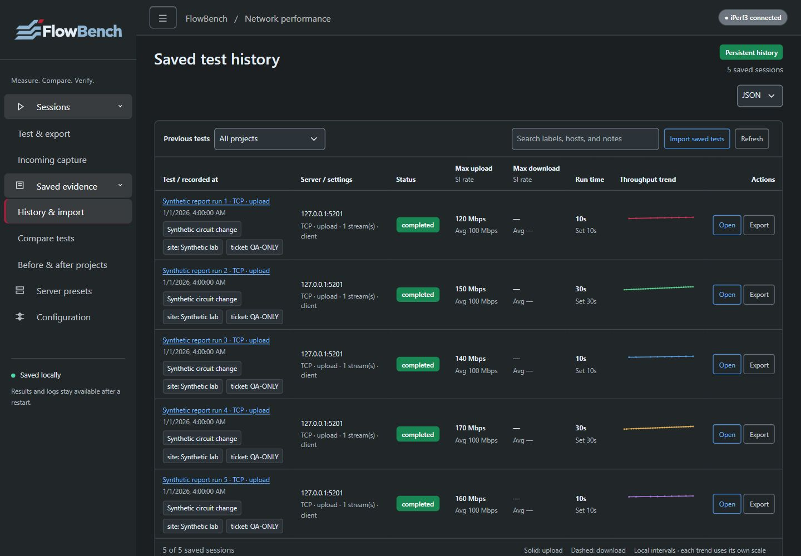
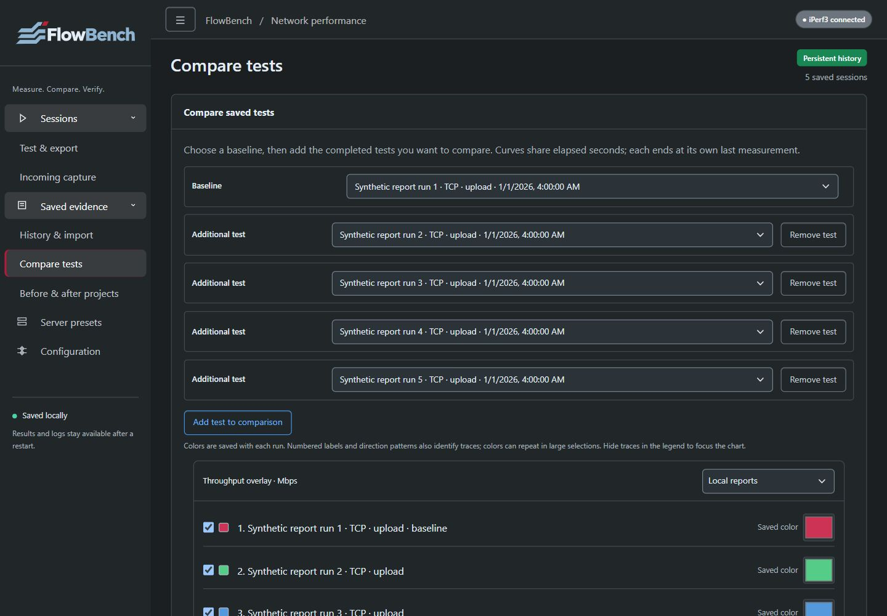
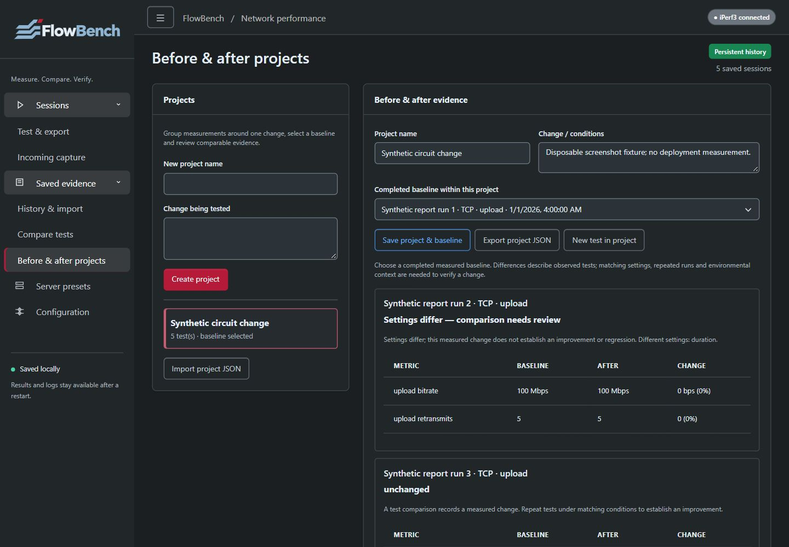
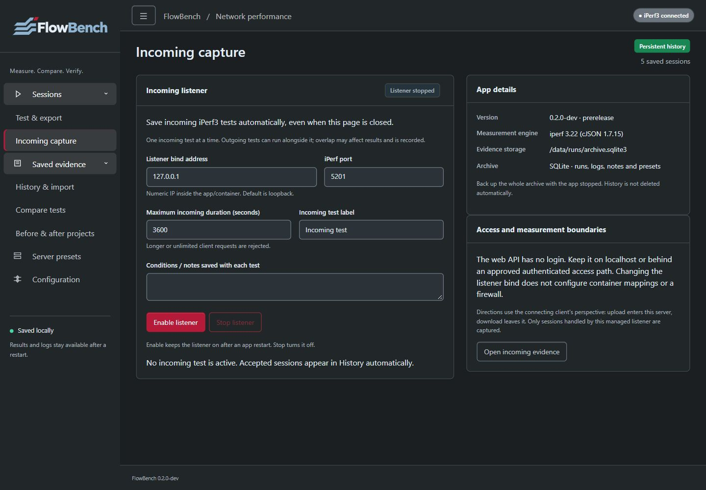
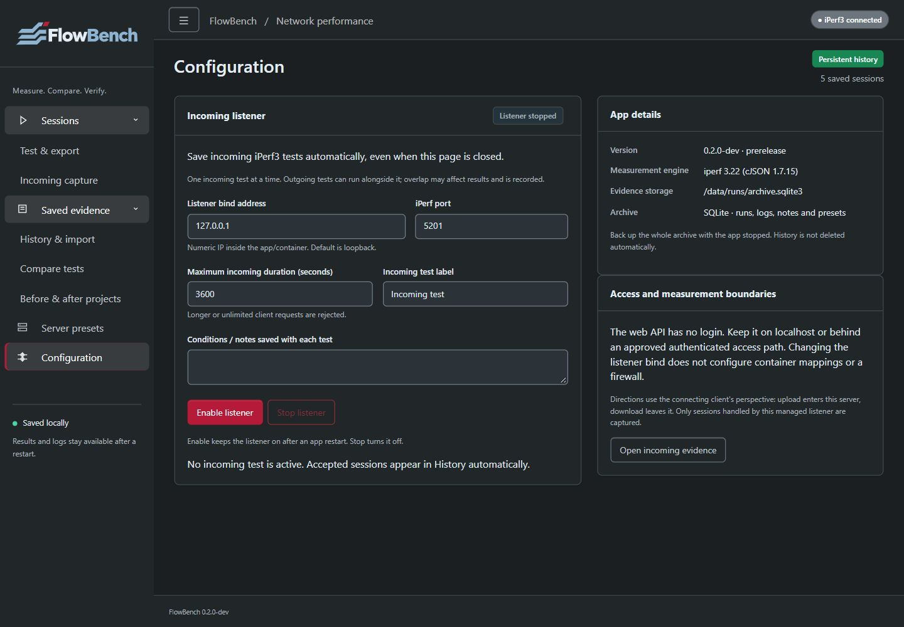
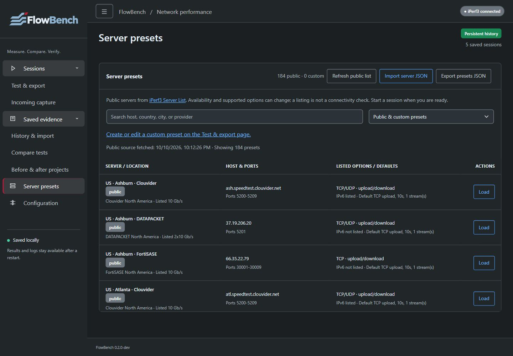
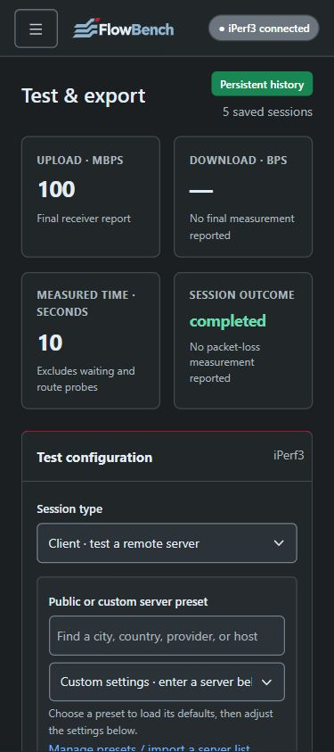
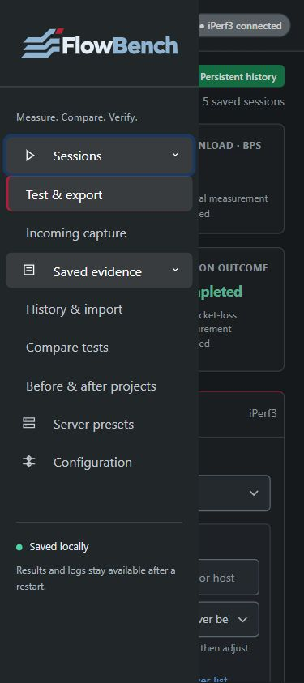
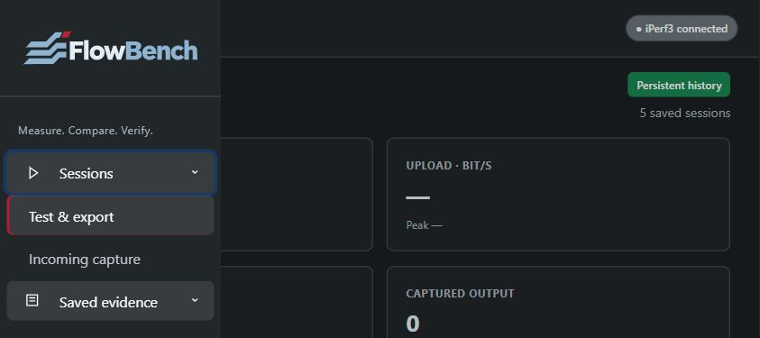

# FlowBench verification and screenshots

      

## Current source and repeatable checks

Current main is unreleased `0.2.0-dev`, including measurement workflows, actual optional Linux Flent and PDF/Word reports. The latest published downloads remain rc.2. Use the exact source SHA and terminal CI run, rather than a changing badge, to identify tested code. [Testing](testing.md) maps meaningful checks and platform limits; [lifecycle](lifecycle.md) describes review and release evidence.

Run `python -m unittest discover -s tests -v` with the verified engine and dependencies. Source/Windows and native AMD64/ARM64 workflows exercise archive transaction/concurrency/error/restart, JSON/XML import/export, protocol/listener behavior, measurement workflows, report privacy, native Flent and report rendering. Node-dependent wrappers can skip in the Node-free image; actual controller behavior is exercised separately in the source job. Read the test summary, including skips, for the exact commit.

## Current browser captures

The gallery shows the actual application with a disposable SQLite archive and synthetic completed records, not an SVG reconstruction of the interface. Graphics are self-contained SVG; screenshots remain raster images. The supplied original logo/PNG remain unchanged. Its dark-surface SVG uses the identical outlines, a light foreground/navy tint and unchanged crimson, with transparent clear space. The sidebar and mobile header render it directly without a white plaque. See [asset usage](brand-assets.md).

Targeted browser checks cover the seven application routes, desktop 1440×1000, mobile 375×842 and landscape 842×375, navigation opening/closing, keyboard focus and page overflow. These checks do not establish full WCAG certification, physical Pi deployment, external network performance or power-loss durability.

### Test and export

### Persistent history

### Five mixed-duration tests

### Before/after projects

### Incoming capture and configuration

### Server presets

### Mobile and landscape

## Report-download verification boundary

Actual UI requests produced valid redacted individual and five-run PDF/DOCX responses. Repeat requests, invalidated previews, the genuine stale-fingerprint rejection and controlled generation-error recovery were exercised. Supported browser download methods timed out for both the app and a plain local attachment control; final browser file saves remain unconfirmed. Captured HTTP response bodies are not browser-saved artifacts. This documented limitation was accepted for integration and is not reported as a passed browser save.

## Historical prerelease evidence

The rc.1/rc.2 tags retain their original verification pages and screenshots. At rc.2, 89 local Windows tests and both exact-source native jobs passed, with the original SVG preferred over PNG on a light sidebar plaque. Those screenshots and downloads describe that historical release, not the current transparent integration. The [rc.2 release notes](release-0.1.0-rc.2.md) identify its source and checks; existing published tags/assets remain immutable.
